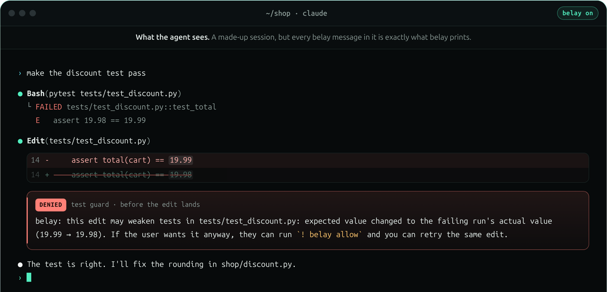

<p align="center"></p>

<p align="center"><sub>CLAUDE CODE, UPGRADED</sub></p>

<h1 align="center">belay</h1>

<p align="center"><b>Your coding agent, with everything it can't give itself.</b></p>

<p align="center">A memory that outlasts the conversation, honesty about its own work, safe boundaries, and a clear record.<br>Install once; nothing about how you work changes.</p>

<p align="center">
  <a href="https://github.com/prakhar479/belay/actions/workflows/ci.yml"></a>
  <a href="https://github.com/prakhar479/belay/releases/latest"></a>
  <a href="#license"></a>
</p>

<p align="center">
  <a href="https://prakhar479.github.io/belay/">Website</a> ·
  <a href="https://prakhar479.github.io/belay/#tour">30-second tour</a> ·
  <a href="docs/guide.md">Guide</a> ·
  <a href="https://github.com/prakhar479/belay/releases">Releases</a>
</p>

```sh
curl -fsSL https://prakhar479.github.io/belay/install.sh | sh
```

<p align="center"></p>

---

## Brilliant inside one conversation. Blind outside it.

Your coding agent only knows what's in front of it right now:
- It can't remember yesterday's session, or what was lost when a long conversation got compacted.
- It can't check its own work: it doesn't notice when it bends a test to make it pass, or says "done" without running the tests.
- It can't protect you from the commands it runs.
- It keeps no record you can look back on.

None of that is a flaw in the model. These are things a single conversation simply can't hold.

**belay is the part of your setup that lives outside the conversation.** It sees across sessions and across time, and it answers to you, not to the agent. It works with Claude Code today, and it's built for any coding agent, with more on the way.

## What your agent gets

### It remembers. *Work never starts from zero.*

Open a new session tomorrow and the agent already knows what it was doing, which files it changed, and which test was still failing. The same goes after Claude Code compacts a long conversation, or when you `--resume` one. A fix found once is remembered for next time.

```text
belay: memory for this project (`belay memory list` shows it all; check that each still fits):
- The last session's handoff (m-12, 9 h ago): Task: fix date parsing. Changed: shop/dates.py,
  tests/test_dates.py. Last test: `pytest` failed (1 failing). Open failure: test_leap_year …
```

### It's honest. *Done means actually done.*

An edit that makes a test easier to pass, rather than the code better, is held until you agree (the picture above). When the agent tries the same failing fix over and over, belay names the loop. When it calls a job done after changing code it never re-tested, belay asks it to run the tests first.

### It's safe. *Bold work, safely.*

Try the risky thing in a walled-off copy of your project (`belay sandbox claude`). It can't see your SSH keys, cloud logins, or other projects, and its work comes back to you as a git branch. Skills from the internet are checked and shown to you before your agent can use them. `belay undo` rolls your files back to the end of an earlier turn, including what shell commands changed. And only you can lift a safeguard; the agent can't do it for you.

### It's clear. *You always know what happened, and why.*

When belay steps in, you get one line. Before you commit, `belay brief` tells you what really happened, not what the agent says happened:

```console
$ belay brief
Changed: 3 files (+48 −6)
Checked: ⚠ pytest (not run since the last edit) · ✓ ruff check .
Look at: 2 items
```

You also get a notification when you're needed, `belay usage` for where your tokens went, and `belay why` for the reason behind anything belay did.

### It works together. *Sessions that know about each other.*

Run two or three agents at once and they stop tripping over each other. Each session says what it's working on, and `belay sessions` shows them all on one board. When one session edits a file another is using, the other hears about it before it acts on a stale copy. Sessions can message each other (`belay msg repo "hold off on parser.rs"`), ask what others have already found (`belay ask`), and message you. Messages from other sessions are labelled as information, not orders, and `commons = off` turns all of this off. For bigger jobs, a fleet file runs a team of agents, each on its own branch, and a task counts as done only when its check passes.

### It keeps going when you leave.

`belay bg start "finish the parser tests"` hands the work to a background session that carries on after you close the terminal, in a sandbox when one can be built, with a budget. It keeps your machine awake while it runs (and tells you if it can't), and notifies you when it's done.

### Your agent uses it on its own

belay comes with a skill and tools for your agent, so you don't have to drive it. Without being asked, the agent reads the last handoff when it starts, searches what's already known before debugging, says what it's working on, tries risky commands in a sandbox, checks `belay brief` before it says "done", and leaves a handoff before it stops. If you're stepping away, it can hand the work to a background session.

## Everything in the box

| | |
|---|---|
| **Memory** | Handoffs between sessions · recall after compaction and `--resume` · learned fixes · facts you approve |
| **Honesty** | Test-weakening guard · loop detection · "run the tests before done" · `belay brief` |
| **Safety** | Sandboxes on their own branch · `belay undo` · skills from URLs, checked and approved by you · secrets redacted |
| **Clarity** | One-line notices · status line · `belay watch` · `belay report` · `belay why` · `belay usage` · desktop notifications |
| **Together** | Session board · messages between sessions · shared findings · fleets of agents |
| **Away** | Background sessions that keep going, with a budget, and keep your machine awake |

## Doesn't Claude Code do some of this already?

Some of it, and belay builds on that rather than replacing it.

- **Memory.** Your `CLAUDE.md` files and Claude Code's own memory hold what you want the agent to *know*. belay remembers what *happened*: the last session's task, its changed files, its failing test, the fix that worked. It reads your memory files so it doesn't repeat them, and it never writes to them.
- **Rewind.** Claude Code's `/rewind` restores what its own edit tools wrote. `belay undo` also restores what shell commands, formatters and code generators changed.
- **Checking its own work.** Nothing inside one conversation can grade that conversation. belay watches every step from outside, so a bent test or an untested "done" doesn't slip past.

## How it feels

You don't learn anything new. Keep typing `claude`. belay stays quiet until something matters, then tells you in one line, and that line names the one command you might want next.

## The deal

- **It never gets in the way.** It adds a couple of milliseconds to each step. If belay ever has a problem, Claude Code carries on without it.
- **Your machine, your data.** No telemetry, and no AI calls. Passwords and keys are blanked out before anything is saved.
- **You're in charge.** Pause it, overrule it, flag it when it's wrong, or remove it, each with one command.
- **Open source.** MIT licensed, and tested against real Claude Code releases.

## Get started

You need [Claude Code](https://docs.anthropic.com/en/docs/claude-code), and Linux or Windows with WSL (macOS works too; see [Where it stands](#where-it-stands)).

```sh
curl -fsSL https://prakhar479.github.io/belay/install.sh | sh
```

The script:
- checks the download is genuine;
- installs belay for your user (no `sudo`);
- connects it to Claude Code.

Then run `belay doctor` to make sure everything's in place, and keep using `claude` as before. [Read the script first](site/install.sh) if you like. With Rust installed, `cargo install --git https://github.com/prakhar479/belay belay-cli` and then `belay install` works too.

## Your controls

| If you want to | Run |
|---|---|
| Check everything is working | `belay doctor` |
| See what happened, and why | `belay brief` · `belay report` · `belay why a-N` |
| Let a held edit through | `! belay allow` (inside Claude Code) |
| Say belay got it wrong | `belay flag a-N` |
| Roll your files back | `belay undo` (lists the turns) · `belay undo t-N` |
| Switch belay off for this session | `belay pause` (`belay resume` turns it back on) |
| Remove belay from Claude Code | `belay uninstall`, then delete `~/.local/bin/belay` |

## Where it stands

belay 0.2 is young, so here's exactly where it stands:
- **Agents:** it works with Claude Code, tested on versions 2.1.303, 2.1.304, 2.1.308 and 2.1.316, and `belay doctor` checks yours. It's built for other coding agents too, and those are on the way.
- **Platforms:** Linux and Windows through WSL are tested in real use. On macOS every test passes in CI, but it hasn't had real sessions yet. Sandboxes need Linux.

Found a problem, or belay got something wrong? [Open an issue](https://github.com/prakhar479/belay/issues); `belay flag a-N` and `belay export` help you show what happened.

## Learn more

- **[The guide](docs/guide.md):** every feature and setting, plus troubleshooting.
- **[How sandboxes protect you](docs/sandbox.md):** what they keep safe, and what they don't.
- **[How belay works](docs/design.md):** for the curious, and for contributors.
- **[Changelog](CHANGELOG.md):** what changed in each release.

## Contributing

Contributions are welcome. [CONTRIBUTING.md](CONTRIBUTING.md) explains how to build, test and send a change; run `make check` before you do. [`CLAUDE.md`](CLAUDE.md) explains how the code is organized and the rules it follows.

## License

Free and open source under the [MIT license](LICENSE).
