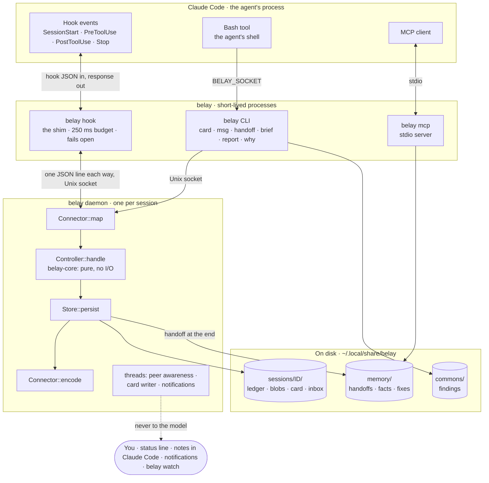

# How belay works

This page is for the curious and for contributors. To use belay, read [the guide](guide.md).

## The idea

A coding agent knows only what is in its conversation. belay is the part of your setup that lives outside it. It watches each step the agent takes, keeps a record, and steps in when something matters: a test edit that makes a test easier to pass, the same failing fix tried again and again, a session that ends without a handoff.

belay never calls a model. Everything it decides comes from rules applied to what the agent did, so the same session always gives the same decisions.

## The pieces

```
Claude Code ──hook──▶ belay hook ──socket──▶ belay daemon ──▶ connector ──▶ controller
     ▲                (the shim)              (one per session)               │
     └──────────── response ◀──────── connector ◀── decision ◀────────────────┘
                                                        │
                                                        ▼
                                                  ledger (JSONL) + blobs
```

- **The shim** (`belay hook <Event>`) is what Claude Code runs on each hook. It forwards the hook's JSON to the session's daemon and prints the answer. It is kept small and fast (about 2 ms at the median), and it **fails open**: on any error or timeout it prints nothing and exits 0, so the agent carries on as if belay were not there.
- **The daemon** holds one session's state behind a Unix socket. It is started by `belay claude`, or by the plugin's first hook.
- **The connector** translates between one agent's hook format and belay's own vocabulary of events. Claude Code is the first connector. Adding an agent means a new connector, its fixtures, and a list of what that agent supports. The core does not change.
- **The controller** is belay's judgment. It takes an event, updates the session's state, and returns a decision: what to record, and what (if anything) to answer.
- **The ledger** is an append-only JSONL file per session. Every action belay takes is in it, with a one-sentence reason and the entries that caused it. `belay why a-N` reads that chain back.

## Under the hood

The full picture: processes, what they say to each other, and what they keep on disk.



One hook call, step by step:

1. Claude Code runs `belay hook PreToolUse` and writes the hook's JSON to its stdin.
2. The shim sends it, as one JSON line, over the session's Unix socket. If no answer comes within 250 ms, or anything fails, the shim prints nothing and exits 0. Claude Code carries on as if belay were not there.
3. The daemon's connector maps the payload to a neutral event (`ToolRequested`, with a tool kind such as `Shell` or `Edit`).
4. The controller, in `belay-core`, updates the session model and decides. It gets the time as an argument and touches nothing else.
5. The decision's ledger entries and output blobs are written. Only then is a response sent, so nothing reaches the agent that isn't recorded.
6. The connector encodes the response in Claude Code's format: allow, deny with a reason, added context, a notice for you, or nothing at all.

What lives where:

| Path under `~/.local/share/belay` | Holds | Written by |
|---|---|---|
| `sessions/<id>/ledger.jsonl` | Every event, output, action, and notice, append-only | The daemon |
| `sessions/<id>/blobs/` | Full tool outputs, by SHA-256 (`belay show o-N`) | The daemon |
| `sessions/<id>/card.json`, `inbox.jsonl` | What the session is doing; messages to it | The daemon, `belay msg` |
| `memory/` | Handoffs, facts, decisions, learned fixes, per project | The daemon at session end, `belay memory`, MCP |
| `commons/findings.jsonl` | What sessions shared with `belay share` | `belay share` |
| `sandboxes/<id>/` | A sandbox's clone and private home | `belay sandbox` |
| `by-session/<conversation id>` | Which belay session a Claude Code conversation is | The plugin, the launcher |

## Two crates

- **`belay-core`** is the judgment, and nothing else. It does no I/O at all: no files, sockets, environment, clocks, threads, or model calls. Time comes in as an argument. This keeps every decision testable in milliseconds and replayable from a ledger. It knows nothing about Claude Code: it works with tool kinds (shell, edit, read, …) and capabilities.
- **`belay-cli`** does all the I/O: the CLI, the daemon, the shim, the connector, the store, sandboxes, background sessions, and the fleet hub.

## Rules the code keeps

1. **Fail open.** A hook never blocks the agent because belay broke. The one exception is a sandbox, which **fails closed**: if it cannot be built as asked, nothing runs.
2. **The core has no I/O.**
3. **Never edit the past.** belay acts only on what the agent has not seen yet.
4. **Every action is recorded**, with its reason and causes.
5. **Reporting never reaches the model.** Notes for you go through channels only you see: Claude Code's user messages, the status line, `belay watch`, the exit summary. Only actions reach the agent.
6. **Deterministic.** Hashes are SHA-256; nothing depends on hash-map order.
7. **The shim stays thin.** p95 under 20 ms.
8. **Capability-honest.** belay plans with what the agent actually supports, and does less rather than fail.
9. **Few dependencies** in the core, each with a reason.
10. **Parsers need fixtures.** Every change to how belay reads a command or an output comes with a captured example and a test.
11. **Network only on request.** Only `belay skill` fetches anything, and only when you run it. The hook path, the daemon, and the core never touch the network.
12. **You approve what lasts or escapes.** Lifting a block, pausing belay, undoing, approving a memory or a skill, and removing a sandbox are yours. belay refuses them outside your own terminal, and denies the agent's attempts.

## Where things live

| You see | It lives in |
|---|---|
| The test guard | `belay-core/src/guard.rs` |
| Loop detection | `belay-core/src/loops.rs` |
| Summaries of test output | `belay-core/src/shape.rs`, `perception/` |
| Memory, handoffs, recall | `belay-core/src/memory.rs`, `controller/memory.rs`, `belay-cli/src/memorystore.rs` |
| Sessions that see each other | `belay-core/src/commons.rs`, `belay-cli/src/commons.rs` |
| Sandboxes | `belay-cli/src/sandbox/` and [sandbox.md](sandbox.md) |
| Background sessions | `belay-cli/src/bg.rs` |
| Fleets | `belay-core/src/fleet/`, `belay-cli/src/hub.rs` |
| The plugin, skill, and MCP tools | `plugin/`, `belay-cli/src/mcp.rs` |

[`CLAUDE.md`](../CLAUDE.md) has the full module map. Claude Code reads it when it works on belay, so it is kept exact.

## Checking belay against Claude Code

belay depends on details of Claude Code's hooks: payload fields, which messages the model sees, how a blocked stop continues. `scripts/conformance.py` runs a short scripted session against the installed Claude Code and checks each of them. Results for each tested version are in [`conformance/`](conformance/).
